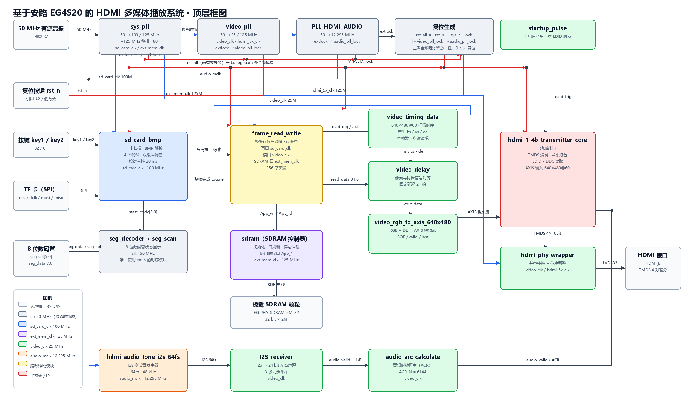

# 顶层框图 · 时钟表 · 复位链路说明

| 项目 | 内容                                                                          |
| ---- | ----------------------------------------------------------------------------- |
| 版本 | v0.2                                                                          |
| 日期 | 2026-10-07（v0.2：三个 PLL 的 lock 全部参与复位）                            |
| 依据 | 官方例程 lab_ex5_i2s 的 top_tf_hdmi_audio.v 与全部子模块、timing.sdc、pin.adc |
| 配图 | top_block_diagram.svg（矢量）/ top_block_diagram.png（位图）                  |

---


## 1. 顶层框图



### 1.1 图例

整张图按功能分成三个区：

**时钟与复位区（顶部）**——左边是唯一的板级 50 MHz 晶振，向右分出三个 PLL，再往右是复位生成逻辑。三个 PLL 全部以 50 MHz 为输入，各自产出成组时钟。

**视频主通路（中部，从左到右）**——这是系统的主干：

TF 卡 → sd_card_bmp（扫描与 BMP 解析）→ frame_read_write（帧缓存调度）→ SDRAM 控制器 → 板载 SDRAM 颗粒，读回方向再经 video_timing_data / video_delay 对齐，转成 AXIS 视频流送进 HDMI 加密核，最后经 PHY 输出 TMDS 差分信号到 HDMI 接口。

**音频通路（底部，橙色起）**——PLL_HDMI_AUDIO 产生 12.295 MHz 主时钟，驱动 I2S 测试音发生器；I2S_receiver 把它还原成 24 bit 左右声道采样，audio_arc_calculate 算出音频时钟再生参数（ACR），三路一起送进 HDMI 核。

图上的**颜色代表时钟域**，这是这张图最重要的信息：

| 颜色         | 含义                                                       |
| ------------ | ---------------------------------------------------------- |
| 灰（虚线框） | 外部器件：晶振、按键、TF 卡、板载 SDRAM、数码管、HDMI 接口 |
| 浅灰蓝       | clk 原始时钟域（50 MHz）                                   |
| 蓝           | sd_card_clk（100 MHz）                                     |
| 紫           | ext_mem_clk（125 MHz）                                     |
| 绿           | video_clk（25 MHz）                                        |
| 橙           | audio_mclk（12.295 MHz）                                   |
| 黄           | 跨时钟域模块（frame_read_write 一个模块跨三个域）          |
| 红（双线框） | 加密核与 IP                                                |

实线是数据与控制，虚线是时钟与复位。连线上的文字是信号名（写报告时可以直接照抄）。

### 1.2 三个跨时钟域边界

整个系统高风险跨时钟域有三处，在图上用连线标出：

1. **sd_card_clk → ext_mem_clk**：帧写入完成信号 write_finish 不能直接跨域，工程里先把它变成 toggle 电平（frame_write_toggle_mem），再进 sd_card_clk 域做同步。这是一位信号跨域的经典做法。
2. **ext_mem_clk → video_clk**：整帧像素的读出，走的是内部异步 FIFO，不是简单的打拍。
3. **audio_mclk → video_clk**：I2S 的 BCLK / LRCK / DOUT 三根线，靠 I2S_receiver 内部的 3 级采样同步。

### 1.3 数据流

TF 卡里的 640×480 24 位 BMP，被解析成 32 位像素字（有效位在高 24 位），按帧写入 SDRAM 的双缓冲之一；视频时序电路按 640×480@60 的节拍逐像素读出另一个缓冲区，转成 AXIS 视频流交给 HDMI 加密核；同时另一条独立的音频链路产生 48 kHz I2S 测试音，一并打包进 HDMI 数据流。

---

## 2. 时钟表

### 2.1 PLL 配置与输出

| PLL 实例     | 输入   | VCO      | 输出脚 | 频率       | 相位   | 得到的时钟名    |
| ------------ | ------ | -------- | ------ | ---------- | ------ | --------------- |
| sys_pll_m0   | 50 MHz | 1000 MHz | C0     | 100 MHz    | 0 度   | sd_card_clk     |
|              |        |          | C1     | 125 MHz    | 0 度   | ext_mem_clk     |
|              |        |          | C2     | 125 MHz    | 180 度 | ext_mem_clk_sft |
| video_pll_m0 | 50 MHz | 1000 MHz | C0     | 25 MHz     | 0 度   | video_clk       |
|              |        |          | C1     | 125 MHz    | 0 度   | hdmi_5x_clk     |
| u_audio_pll  | 50 MHz | 750 MHz  | C0     | 75 MHz     | 0 度   | 未使用          |
|              |        |          | C1     | 375 MHz    | 90 度  | 未使用          |
|              |        |          | C2     | 12.295 MHz | 0 度   | audio_mclk      |

说明：频率与相位取自各个 IP 文件头部的注释（IP 生成器自动写入），可直接引用。VCO 一列是我按 IP 的分频参数反推的（视频与系统 PLL 的 VCO 为 1000 MHz，音频 PLL 为 750 MHz），建议在 TD 里打开对应 IP 配置界面核对一次再写进报告。

### 2.2 时钟域分配

| 时钟域          | 频率             | 该域内的模块                                                                                                                                        | 复位            |
| --------------- | ---------------- | --------------------------------------------------------------------------------------------------------------------------------------------------- | --------------- |
| clk             | 50 MHz           | seg_scan（seg_decoder 为纯组合逻辑，没有时钟）                                                                                                      | rst_n（低有效） |
| sd_card_clk     | 100 MHz          | sd_card_bmp（内含 sd_card_top、spi_master、bmp_read、key_press_debounce）、frame_read_write 的写口                                                  | rst_all         |
| ext_mem_clk     | 125 MHz          | frame_read_write 主控、sdram 控制器、板载 SDRAM 颗粒                                                                                                | rst_all         |
| ext_mem_clk_sft | 125 MHz / 180 度 | 仅用于 SDRAM 数据采样移相                                                                                                                           | 不占逻辑        |
| video_clk       | 25 MHz           | video_timing_data、video_delay、video_rgb_to_axis_640x480、I2S_receiver、audio_arc_calculate、startup_pulse、HDMI 加密核、hdmi_phy_wrapper 的并行侧 | rst_all         |
| hdmi_5x_clk     | 125 MHz          | hdmi_phy_wrapper 的串行侧                                                                                                                           | rst_all         |
| audio_mclk      | 12.295 MHz       | hdmi_audio_tone_i2s_64fs                                                                                                                            | rst_all         |

### 2.3 时序约束（timing.sdc）

| 约束语句                                                | 作用                                                                                     |
| ------------------------------------------------------- | ---------------------------------------------------------------------------------------- |
| create_clock -name clk -period 20 [get_ports clk]       | 声明板级 50 MHz 输入主时钟                                                               |
| derive_clocks                                           | 让工具自动推导三个 PLL 的输出时钟                                                        |
| rename_clock（5 条）                                    | 给 sd_card_clk、ext_mem_clk、video_clk、hdmi_5x_clk、audio_mclk 起名，名字必须与上图一致 |
| set_clock_groups -exclusive（video_clk 与 hdmi_5x_clk） | 同源互斥，不做两者之间的时序分析                                                         |
| set_clock_groups -asynchronous（audio_mclk 与其余全部） | 音频域声明为异步                                                                         |

要特别注意最后一条的**反面**：sd_card_clk、ext_mem_clk、video_clk 三者之间**没有**做任何豁免。这意味着任何新增的跨域路径都会在时序报告里暴露出来，这是好事，千万别为了消掉告警而私自加豁免——一旦加了，真正的跨域冒险就被藏起来了。

### 2.4 视频、音频通路频率取舍

**视频像素时钟为什么是 25.000 MHz 而不是标准的 25.175 MHz？**
640×480@60 的标准像素时钟是 25.175 MHz。本工程用 25.000 MHz，因为它能由 50 MHz 整数分频得到（反推 VCO 1000 MHz，除以 40）。代价值得算清楚：一帧是 800 × 525 = 420000 个像素时钟，25000000 / 420000 ≈ **59.52 Hz**。也就是说实际刷新率是 59.5 Hz 而不是 60 Hz。绝大多数显示器能接受（VESA 允许一定容差）。

**音频主时钟为什么是 12.295 MHz？**
48 kHz 采样率配 256 倍过采样是 12.288 MHz，本工程是 12.295 MHz，偏高约 0.058%（约 1 kHz）。对应到音高上大约偏高 1 音分，人耳听不出来，可以接受。

### 2.5 带宽验算

| 项目                                         | 数值                                                  |
| -------------------------------------------- | ----------------------------------------------------- |
| 显示带宽需求                                 | 640 × 480 × 3 字节 × 59.5 Hz ≈**54.8 MB/s** |
| SDRAM 接口理论峰值                           | 125 MHz × 32 bit =**500 MB/s**                 |
| 理论余量                                     | 约 9 倍                                               |
| 扣除刷新、行列激活、读写切换开销后的实际余量 | 约 4 到 5 倍                                          |

单缓冲区、无缩放、无叠加的前提下，SDRAM 带宽非常充裕。后面要加图片转场（双缓冲同时读写）或 OSD 叠加时，这个余量就是要用的地方。

---

## 3. 复位链路说明

### 3.1 复位源

全工程只有板载按键一个复位源，最终合成一个全局复位 rst_all：

```
                 rst_n（板载按键，引脚 A2，低有效）
                    │
                    ├──────────────→ seg_scan（全工程唯一例外，直接用 rst_n）
                    │
                    └──→ 取反 ──┐
   sys_pll_lock   ──→ 取反 ────┤
   video_pll_lock ──→ 取反 ────┼──→ OR ──→ rst_all（高有效、异步）
   audio_pll_lock ──→ 取反 ────┘                 │
                                                  └──→ 其余全部模块的异步复位端
```

对应源码只有一行：

```
assign rst_all = ~rst_n | ~audio_pll_lock | ~video_pll_lock | ~sys_pll_lock;
```

**只要复位按键被按下（rst_n 为 0），或者三个 PLL 中任意一个还没锁定，rst_all 就保持 1，全系统一直被按在复位状态。** 三个锁定信号分别来自 sys_pll.extlock、video_pll.extlock、PLL_HDMI_AUDIO.extlock（2026-10-07 补齐）。

### 3.2 覆盖范围

| 模块                                             | 复位信号 | 极性   |
| ------------------------------------------------ | -------- | ------ |
| seg_scan（seg_decoder 是纯组合逻辑，不需要复位） | rst_n    | 低有效 |
| 其余全部模块（含三个 PLL 之外的所有逻辑）        | rst_all  | 高有效 |

### 3.3 上电时序（POR 全过程）

| 阶段 | 事件                                                                                 | 时间尺度                     |
| ---- | ------------------------------------------------------------------------------------ | ---------------------------- |
| 1    | 板卡上电，50 MHz 晶振起振并稳定                                                      | 毫秒级                       |
| 2    | 三个 PLL 开始锁定；此时三个 lock 信号都还是 0                                        | 典型几十微秒                 |
| 3    | rst_all 保持 1，除 seg_scan 外全部模块处于复位                                       | —                           |
| 4    | sys_pll_lock、video_pll_lock、audio_pll_lock 全部拉高，且复位按键没被按下，rst_all 释放为 0 | —                           |
| 5    | SDRAM 控制器开始初始化，Sdr_init_done 拉高后帧缓存才允许工作                         | 数百微秒                     |
| 6    | sd_card_bmp 从扇区 0 开始扫描 BMP，最多扫到扇区 131071，找到 4 张图即停止            | 取决于图片在卡上的位置，秒级 |
| 7    | 逐帧写入 SDRAM 的 BUF0（起始地址 0），写完产生 write_finish，跨域送到 sd_card_clk 域 | —                           |
| 8    | display_valid 置 1，画面开始输出；在此之前 vout_data 被强制为 0，即黑屏              | —                           |
| 9    | startup_pulse 计满 100000 个 video_clk（约 4 毫秒）后，触发一次 EDID 读取            | 4 毫秒                       |

第 6 步的扫描上限是 131072 个扇区（约 64 MB），这是最坏情况；实际上找到第 4 张图就停。上板时如果迟迟不出图，先看数码管显示的状态码，再判断是卡在扫描、读卡还是写缓存。

### 3.4 三个已知问题（问题一已解决，二、三待观察）

**问题一（已于 2026-10-07 解决）：三个 PLL 的锁定现在都参与复位。**
原先 sys_pll 和 video_pll 的 IP 端口里没有 lock 输出（只有 refclk、reset、clk0_out 到 clk2_out），rst_all 只看得到音频 PLL 的锁定状态，与《设计参考例程》"确保所有 PLL 完全锁定且稳定后才启动系统"的描述不一致。处理办法：在 IP 工具里勾选 PLL lock 重新生成这两个 PLL 以引出 extlock，顶层例化接出 sys_pll_lock、video_pll_lock 并纳入 rst_all 表达式。**注意 PLL 自身的 .reset() 必须保持接 1'b0**——若接回 rst_all 会形成 rst_all → PLL 复位 → lock → rst_all 的组合环。


**问题二：rst_all 没有同步释放。**
它仍是一条纯组合逻辑，三个 lock 中任意一个抖动一下，rst_all 就会立刻翻转，全系统被异步复位。工程上的常规做法是异步断言、同步释放（每个时钟域各自打两拍后再释放）。当前设计依赖 PLL 的 lock 信号本身足够稳，属于能工作但余量不足，上板长时间运行测试时要重点观察。

**问题三：seg_scan 是唯一绕过 rst_all 的模块。**
它直接用板载按键 rst_n。上电瞬间数码管可能先显示一个无效状态码，与主系统的复位状态不同步。因为它只驱动数码管，风险很低，但写报告时要解释清楚这个例外存在的原因。
